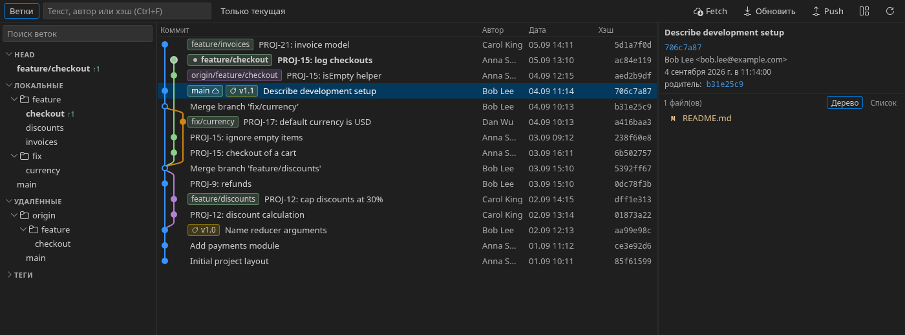
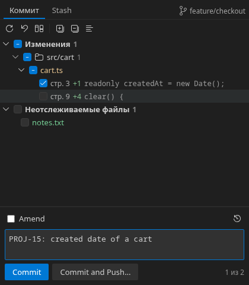
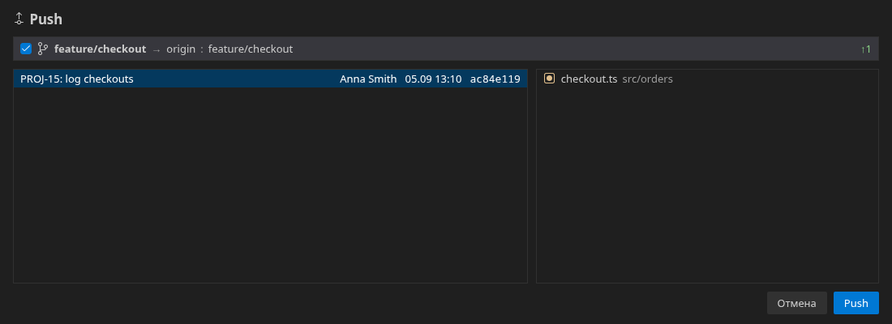
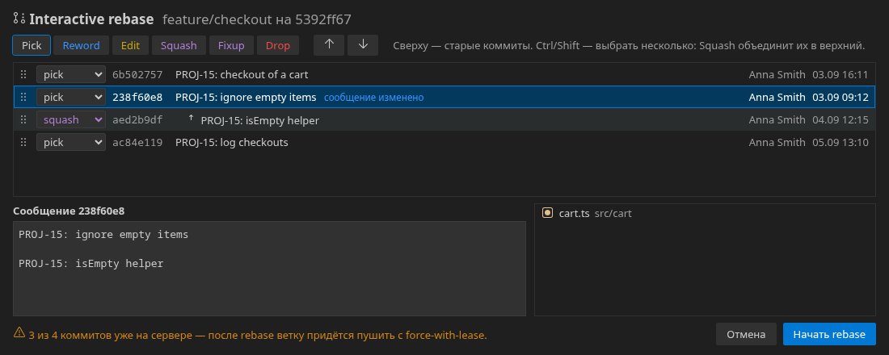
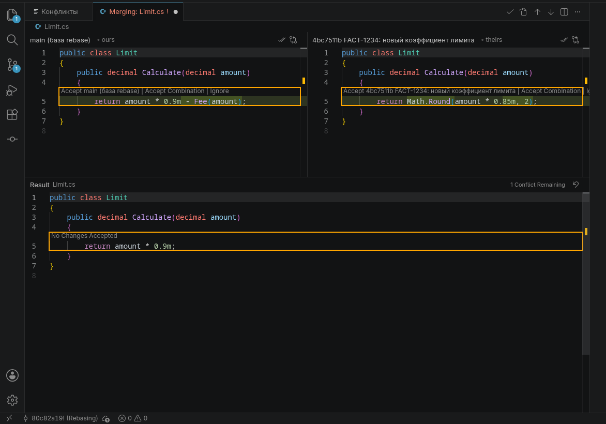

# Grove

Git for VS Code and VSCodium the way JetBrains IDEs do it: a commit graph you can work from, one diff
viewer for any set of changes, history and blame a click away, interactive rebase and conflicts in proper
windows, GitLab merge requests and review inside the editor.

Built for a day where code is mostly written by agents and colleagues, and your job is to read it: every
change opens in the native diff editor with the language server working, and the file on the right side
stays editable.

[Русская версия](README.ru.md) · The interface is in Russian for now; English is planned.



## Features

**Log and diffs**

- **Commit graph** for every branch, remote and worktree, virtual scrolling for repositories with tens of
  thousands of commits, filter by text, author or hash, speed search by typing.
- **Branch panel**: HEAD, favorites, local and remote branches as a tree, tags, stashes, ahead/behind
  counters; **focus** limits the log to chosen branches.
- **One diff viewer for any set of changes** on the native diff editor: `F7` / `Shift+F7` go through
  changes and on into the next file, `F4` opens the file for editing. When a revision matches the file on
  disk, the right side _is_ that file.
- **History and blame**: history of a file or of selected lines with the diff beside it, blame annotations
  linked to the log, the main author above declarations.

**Changing history**

- **Commit view**: changes with checkboxes, **parts of a file by hunks**, amend, recent messages, rollback
  of files or hunks, stashes. Parts are committed through a temporary index — what you staged yourself
  stays as it is.

  

- **Branches**: checkout (smart checkout through a stash; replacing a local branch that diverged after a
  rebase on the server, with a check that nothing is lost), checkout into a new worktree, merge, rebase,
  cherry-pick, revert, reset. A stopped operation shows a bar with Continue / Skip / Abort.
- **Update Project** fetches every remote and brings the current branch up to its upstream; another
  branch without own commits is updated without checking it out.
- **Push dialog**: outgoing commits of every branch with their diffs; a diverged branch goes only with
  force-with-lease against what the dialog showed, never into protected branches.

  

- **Interactive rebase**: pick, reword, edit, squash, fixup, drop; select several commits and squash them
  into one; reorder by dragging or `Alt+↑/↓`; messages are edited right in the dialog. Git never opens an
  editor.

  

- **Conflicts**: a list of conflicted files with the real names of both sides, take one side, or merge in
  the built-in three-way merge editor; "Complete merge" marks the file resolved and offers to go on.

  

**GitLab** (GitHub: links only, for now)

- Without a token: links to commits, branches and files, merge request numbers in the log, creating a
  merge request on push, links to your tracker from commit messages and branch names.
- With the API: merge request status and pipelines in the log, merged merge requests down the whole
  history, a merge request card with jobs and child pipelines, job logs in the editor, retry and manual
  jobs, approve, merge, rebase on the server.
- **Review in the diff viewer**: threads in the code, comments published at once or as drafts, resolve,
  next/previous comment. Every comment is written to a local journal before it is sent, so nothing typed
  is lost.

## Install

Until the extension is published, build it from source (see below) and install the package:
`codium --install-extension grove.vsix` (or `code …`).

GitLab access is taken from the [GitLab Workflow](https://open-vsx.org/extension/GitLab/gitlab-workflow)
extension when it is signed in, or from a personal access token (command «Подключить GitLab…», scope
`api`), kept in the editor's secret storage.

## Settings

| Setting                          | Default                               | What it does                                                                                 |
| -------------------------------- | ------------------------------------- | -------------------------------------------------------------------------------------------- |
| `grove.autolinks`                | `[]`                                  | Rules turning text into links: `{"pattern": "\\bPROJ-\\d+\\b", "url": "https://tracker/$0"}` |
| `grove.hosting.instances`        | `{}`                                  | Hosting type of your own servers, e.g. `{"git.example.com": "gitlab"}`                       |
| `grove.update.method`            | `rebase`                              | How Update Project brings a branch with own commits up to date: `rebase` or `merge`          |
| `grove.push.protectedBranches`   | `["master", "main"]`                  | Branches never force-pushed; `*` works, e.g. `release/*`                                     |
| `grove.worktree.path`            | `${repoParent}/${repoName}-${branch}` | Folder of a new worktree                                                                     |
| `grove.worktree.copyFiles`       | `[]`                                  | Untracked files copied into a new worktree, e.g. local settings with secrets                 |
| `grove.codeLens.authors`         | `true`                                | The main author and the number of others above classes and methods                           |
| `grove.history.showDiffOnSelect` | `true`                                | Show the diff of the selected commit in a history tab                                        |

## Key bindings

`F7` / `Shift+F7` in Grove diffs go through changes and continue into the next file. Keymap extensions (e.g.
IntelliJ IDEA Keybindings) bind the same keys in diff editors, and between two extensions VS Code picks one
unpredictably. User key bindings always win, so add these to `keybindings.json` if F7 stays within one file:

```json
[
  {
    "key": "f7",
    "command": "grove.diff.nextChange",
    "when": "grove.inChangeSet && textCompareEditorVisible"
  },
  {
    "key": "shift+f7",
    "command": "grove.diff.previousChange",
    "when": "grove.inChangeSet && textCompareEditorVisible"
  }
]
```

In the merge editor `Ctrl+Enter` completes the merge and marks the file resolved.

## Development

Requires Node.js 20+ and git.

```sh
npm install
npm run build              # extension and webviews into dist/
npm run watch              # rebuild on change; F5 in VS Code starts an Extension Development Host
npm test                   # unit tests, against real git repositories in a temp folder
npm run test:integration   # tests inside a real editor; GROVE_CODE=/path/to/codium
npm run preview -- <repo>  # the UI in a browser against a real repository; nothing is committed or pushed
npm run package            # grove.vsix
```

On Linux the integration tests run the editor under `xvfb-run` in a throwaway profile.

```
src/shared/     types and logic shared by the extension and the webviews
src/extension/  extension host: git, change sets and the diff navigator, actions, hosting, review
src/webview/    log, commit, push, rebase and conflicts UIs (Svelte 5)
scripts/        build, integration test runner, browser preview, fake GitLab for tests
test/           unit tests (vitest) and integration tests
```

## License

[MIT](LICENSE)
